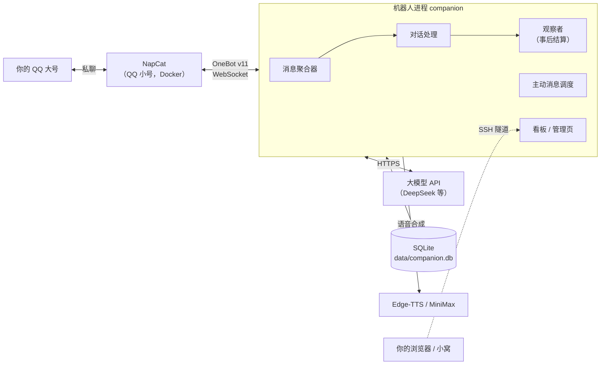
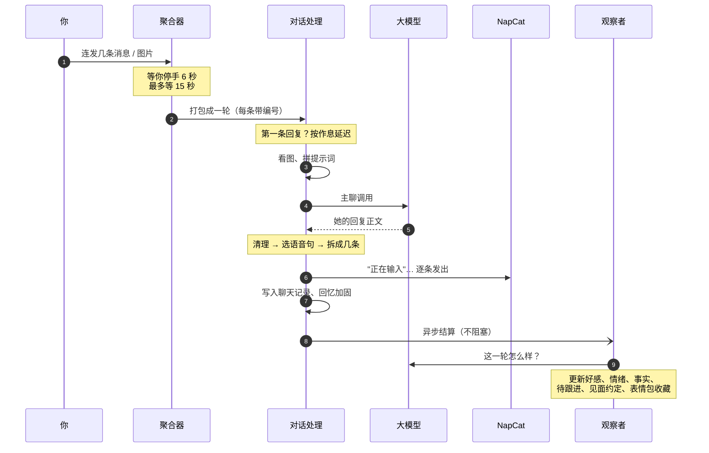
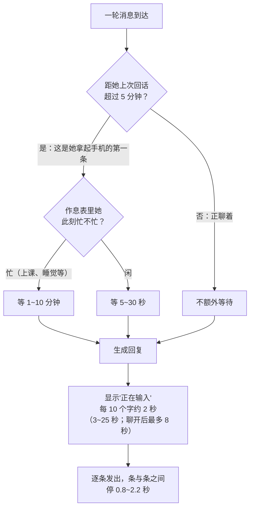
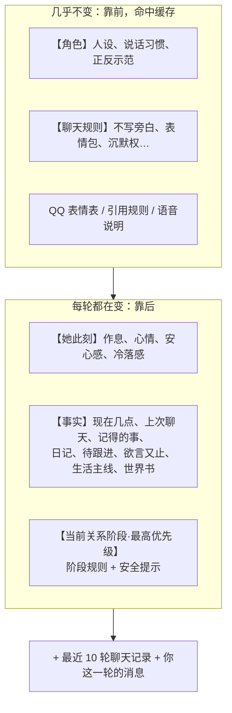
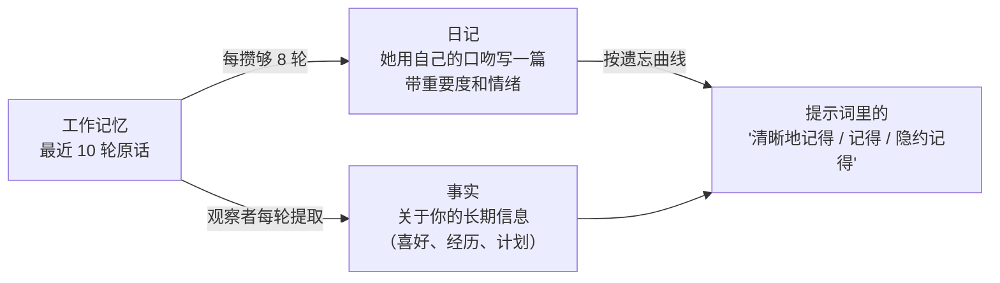
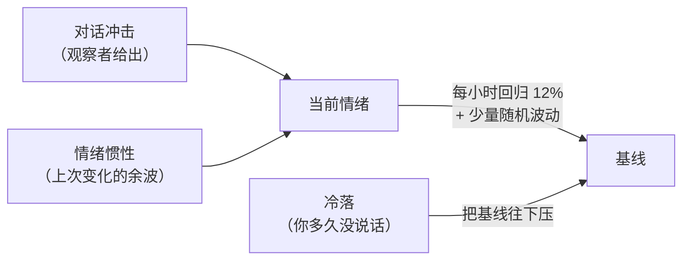
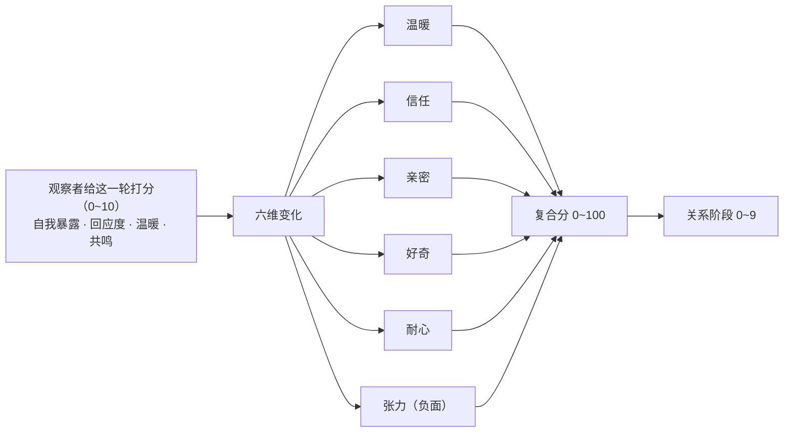
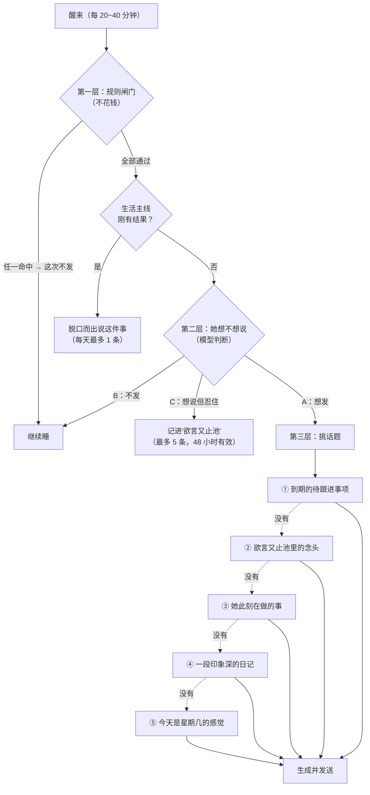
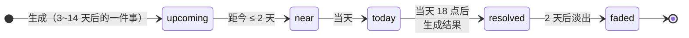
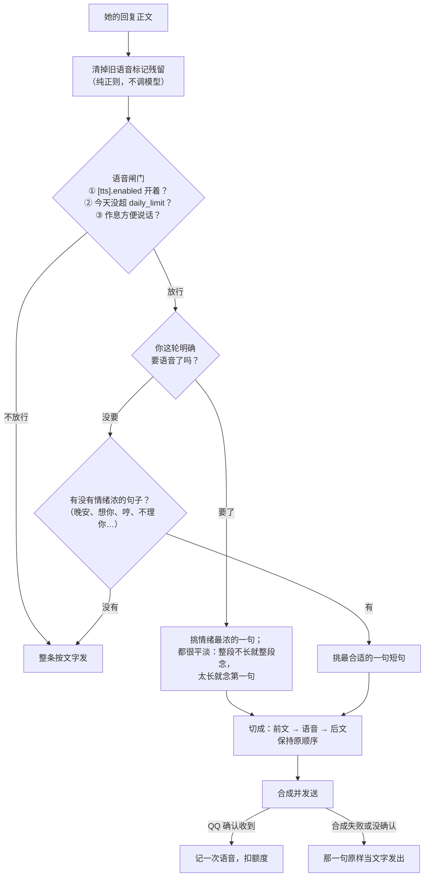

# 原理篇：她是怎么"活"起来的

这篇讲 QQ 伴侣机器人背后的机制：一条消息怎么变成她的回复，她为什么不秒回、为什么会忘事、心情和关系怎么变、什么时候会主动找你，以及语音是怎么挑出来的。

文中的数字都取自代码（文件位置写在每节末尾），改代码时请同步这里。图用 Mermaid 画，GitHub 上可以直接看。

---

## 目录

1. [整体结构](#1-整体结构)
2. [一条消息的旅程](#2-一条消息的旅程)
3. [她为什么不秒回](#3-她为什么不秒回)
4. [提示词怎么拼](#4-提示词怎么拼)
5. [记忆：为什么会忘、怎么想起](#5-记忆为什么会忘怎么想起)
6. [情绪：会波动，也会回落](#6-情绪会波动也会回落)
7. [好感与关系阶段](#7-好感与关系阶段)
8. [她什么时候主动找你](#8-她什么时候主动找你)
9. [她自己的生活：作息与生活主线](#9-她自己的生活作息与生活主线)
10. [语音是怎么挑出来的](#10-语音是怎么挑出来的)
11. [几条贯穿全局的设计纪律](#11-几条贯穿全局的设计纪律)

---

## 1. 整体结构



- **NapCat** 负责登录 QQ 小号，把收到的私聊消息通过 WebSocket 推给机器人，再把她的回复发出去。
- **机器人进程**是一个纯 Python 的异步程序，里面同时跑着几条线：处理你的消息、定时考虑要不要主动找你、事后结算好感和记忆、提供看板网页。
- **所有状态都在一个 SQLite 文件里**：聊天记录、日记、事实、情绪、好感、表情包、费用账本。备份它就等于备份了"她"。

---

## 2. 一条消息的旅程



几个关键点：

1. **先等你说完**。真人聊天经常一句话拆成好几条发。聚合器在你停手 **6 秒**后才认为这一轮说完了；从第一条算起最多等 **15 秒**。NapCat 能上报你"正在输入"时，它会再多等一会儿，但不会无限等。
2. **每条消息带编号**。你连发三条，模型看到的是 `[1] … [2] … [3] …`，她就可以用 `[quote:2]` 精确引用你的第二条来回。
3. **回复先清理再发**。模型的原始输出会经过几道处理：剥掉旧格式的残留标记、按需选出一句发语音、按意思拆成最多 5 条短消息、换算表情和表情包。
4. **结算放到事后**。好感、情绪、记事这些"想一想"的工作交给观察者异步做，不拖慢她回你。

> 代码：`companion/aggregator.py`、`companion/turn_handler.py`（`handle_turn` 里按 1~8 编号的步骤）、`companion/observer.py`

---

## 3. 她为什么不秒回

秒回是机器人最容易露馅的地方。她的回复时机分两段：



- **第一条才延迟**："她拿起手机"的判据是她上一次回话已经过去 5 分钟以上。聊开之后就正常接话，不会每句都拖。
- **延迟先于看消息**：等待发生在看图、拼提示词之前，相当于"她还没看到消息"。等完再去取当时的时间和状态，提示词里的"现在几点"才准确。
- **"正在输入"按字数演**：生成完才知道她要说多少字，所以输入时长在生成之后才算。
- 这些都可以在 `[timing]` 里关掉；出任何异常都会降级成"立即生成立即发送"，不会卡住。

> 代码：`companion/turn_handler.py` 的 `prepare_reply_timing`、`choose_first_reply_delay`、`calc_typing_duration`；参数在 `config.example.toml` 的 `[timing]`

---

## 4. 提示词怎么拼

每轮主聊的系统提示词由一个固定模板拼成。顺序是刻意安排的：**越稳定的内容越靠前**。



为什么这么排：

- **省钱**：模型厂商对"和上次开头相同"的输入部分按缓存价计费，便宜一个数量级以上（以 DeepSeek 为例，缓存命中价约为未命中的五十分之一）。人设、规则这些大块内容放在最前面且每轮不变，大部分输入都能命中缓存。时间、心情这种每轮都变的东西必须放在后面，否则一变就把后面的缓存全废了。
- **阶段规则压轴**：关系阶段决定她此刻该多亲近，放在最后并明写"优先级高于前面所有内容"，防止人设描述把阶段感冲掉。
- **按需带入，不整本塞**：世界书只带最近 4 轮里提到关键词的词条（最多 4 条、1200 字）；日记只带"还记得"的（见下一节）；事实在开启分层后只带核心加最近、相关的几条。

> 代码：`companion/prompts.py` 的 `SYSTEM_PROMPT_TEMPLATE`、`companion/assembler.py`、`companion/lorebook.py`

---

## 5. 记忆：为什么会忘、怎么想起

### 5.1 三层记忆



- **工作记忆**：最近 10 轮原话，原样放进提示词，保证她接得上刚才的话。
- **日记**：每攒够 8 轮你的消息，后台让模型以她的视角写一篇日记，打上重要度（1~10）和情绪（温暖、感动、不安、平静……）。
- **事实**：观察者每轮从对话里提取关于你的事，比如"他最近想学做锅底"。新事实和旧事实冲突时，旧的会被作废替换。

### 5.2 遗忘曲线

日记不会永远留在她脑子里。每篇日记的"记忆强度"随时间指数衰减：

```
强度 = 重要度 × (1 + 0.3 × log₂(被想起次数 + 1)) × e^(−天数 / τ)

τ（时间常数）= max(10, 重要度 × 6.8) 天
             × (1 + 0.15 × 被想起次数)
             × 2（正面情绪）或 × 1.5（负面情绪）
```

强度低于 **0.5** 就算"淡忘了"，不再出现在提示词里。按这个公式，一篇日记能被记住多久：

| 日记 | 大约能记住 |
|---|---|
| 重要度 1 的琐事 | 7 天 |
| 重要度 5 的普通一天 | 78 天 |
| 重要度 8、正面情绪 | 300 天 |
| 重要度 10、正面情绪、被想起过 8 次 | 3 年 |

几个设计上的考虑：

- **带情绪的事记得更久**：正面情绪的时间常数翻倍，负面的乘 1.5，和人一样。
- **心情差时更容易想起难过的事**：她当前心情低落时，负面日记在排序上加权 1.5 倍。
- **按强度分级说法**：强度 ≥ 5 写成"清晰地记得"，≥ 2 写成"记得"，其余"隐约记得"，她说话的笃定程度跟着变。最多带 15 篇。

### 5.3 回忆加固

被想起的记忆会记得更牢：

- 你说"还记得……"或"想你"时，所有还没淡忘的日记被想起次数 +1；
- 你说的话和某篇日记有 **3 个以上相同汉字**时，那一篇 +1。

每次被想起，从这一刻起重新计时，时间常数也变长。**已经淡忘的不会被复活**，避免她突然"想起"一件早该忘了的事。

> 代码：`companion/memory.py` 的 `calc_diary_strength`、`get_active_diaries`、`reinforce_memories`、`check_and_trigger_diary_archive`

---

## 6. 情绪：会波动，也会回落

### 6.1 三个维度

| 维度 | 范围 | 含义 |
|---|---|---|
| 愉悦 v | −10 ~ 10 | 开不开心 |
| 激活 a | −10 ~ 10 | 兴奋还是平静 |
| 安心 t | 0 ~ 10 | 对这段关系有多踏实 |

另外还有一个"冷落感"（0~10），只在你长时间不理她时上升。

### 6.2 均值回归：情绪总会慢慢回到她的基调

情绪用 **Ornstein-Uhlenbeck 过程**建模：受刺激会偏离，但总会被一股"回归力"慢慢拉回基线，同时带一点随机波动。



- **基线随关系变**：愉悦的基线 = 2 + min(2, 好感复合分 ÷ 50)。关系越好，她平时越开心。
- **对话冲击**：观察者每轮给出这一轮让她开心 / 激动 / 安心了多少，单轮冲击有上限（愉悦、激活各 ±2），防止一句话就让她大起大落。
- **情绪惯性**：上一次的变化会留一点余波，情绪不会瞬间翻转。
- **安心感回归很慢**：每天只回归 5%，基线随关系阶段从 3 升到 8 以上。初识时小心翼翼，越熟越踏实。

### 6.3 冷落：按真实时间算

你最后一次说话后的 **12 小时内**不算冷落。之后：

- 愉悦的回归目标被逐渐往下压（每小时 0.15，最多压 4），激活压一半；
- 冷落感按时间累积：一天约 0.24，两天约 2.2，三天约 6，约 89 小时到顶 10；
- 安心感慢慢磨损。

冷落量按"经过了多少小时"积分计算，和程序多久检查一次无关，所以不会因为调度频率不同而让她"更生气"或"没感觉"。你一回话，冷落感开始消退。

她心情差到愉悦 < −6 时，不会主动找你装没事（见第 8 节）。

> 代码：`companion/mood.py` 的 `update_mood`、`neglect_level`

---

## 7. 好感与关系阶段

### 7.1 从一轮对话到六个维度



- **打分换算**：比如温暖维看"温暖"分，亲密维看"自我暴露 + 共鸣"。每轮每维最多变 ±2。
- **越高越难涨**：复合分超过 20 后，涨幅乘一个阻力系数 r = (100 − 复合分) ÷ 80。到 100 时阻力为 0，所以永远不会破百。
- **每天自然衰减**：每维每天扣一点（例如温暖 0.3、信任 0.1、张力 0.8）。不聊天关系会慢慢变淡，按整天扣，零头留到下次。

复合分的权重：

```
复合分 = 0.25×温暖 + 0.25×信任 + 0.25×亲密 + 0.10×好奇 + 0.15×耐心 − 0.30×张力
```

### 7.2 十个关系阶段

| 阶段 | 复合分门槛 | 按标准节奏大约第几天到达 |
|---|---|---|
| 0 | 0 | 开局 |
| 1 | 15.0 | — |
| 2 | 37.6 | 约 6 天 |
| 3 | 57.7 | 约 20 天 |
| 4 | 72.4 | 约 45 天 |
| 5 | 79.4 | 约 75 天 |
| 6 | 85.7 | 约 120 天 |
| 7 | 91.6 | 约 209 天 |
| 8 | 93.9 | 约 342 天 |
| 9 | 99.5 | 设计上到不了 |

"标准节奏"是：每天聊 30 轮、聊六天歇一天、每轮打分中上（用 `scripts/sim/score_simulation.py` 可以复现）。阶段名字和每个阶段的说话方式写在角色卡里。

- **最后一阶到不了是刻意的**：它是方向，不是终点。十年满分聊天也只到约 98.6。
- **不会在门槛上来回闪**：已经到达的阶段，复合分要跌破"门槛 − 1.5"才会掉下去。出门一周回来不掉阶，一个月不聊照样会掉，衰减是真的。
- **角色卡可以设阶段地板**：比如"永远不低于历史最高阶段减 1"。

> 代码：`companion/affection.py` 的 `STAGE_THRESHOLDS`、`calc_resistance`、`calc_composite_score`、`resolve_stage`、`update`

---

## 8. 她什么时候主动找你

主动消息每隔 20~40 分钟（随机）"醒来"一次，经过三层判断：



**第一层规则闸门**，命中任何一条就不发：

- 在免打扰时段（默认 0~8 点）；
- 她上一次说话不到 60 分钟；
- 连续 2 条主动消息你都没回（当天不再发）；
- 上一条主动消息你还没回；
- 你说了"晚安"还不到 6 小时；
- 她心情太差（愉悦 < −6），不装没事；
- 你连续 2 天没回 → 两条主动消息至少隔 48 小时；连续 5 天没回 → 停止主动，你一回话就恢复。

**第二层**让模型以她的身份判断：现在想不想找你。"想说但忍住"的念头不会丢，会进欲言又止池，下次挑话题时优先拿出来。

**第三层**按优先级挑素材。到期的待跟进事项排第一，比如你说过"明天面试"，第二天她会问结果。问过一次就勾掉，你不回也不会天天问。

> 代码：`companion/proactive.py` 的 `trigger_cycle`、`_check_rules_gate`、`_silence_gate`、`_select_topic_material`、`_try_event_channel`

---

## 9. 她自己的生活：作息与生活主线

**作息表**写在角色卡的 `daily_routine` 里，按小时（可以分工作日和周末）描述她在做什么。它影响三件事：

- 提示词里的【她此刻】；
- 第一条回复延迟多久（忙 1~10 分钟，闲 5~30 秒）；
- 能不能发语音（睡觉、上课这类场景不方便说话；你点名要语音时会放行）。

**生活主线**解决"她的生活是即兴编的，说完就蒸发"的问题：



- 她手上同时有 2~3 件"接下来要做的事"（比如一次考试、一趟出门），按日期往前推进；
- 到了那天 18 点后，这件事会有一个结果，并触发一条"脱口而出"的主动消息；
- 主线只往提示词里加事实，不碰情绪和好感。它出任何问题都静默降级，不影响聊天。

角色卡的 `life_arc_seed_pool` 决定主线从哪些题材里生，`calendar_anchors` 给出开学、考试周这类日历锚点。

> 代码：`companion/persona.py`、`companion/arcs.py`

---

## 10. 语音是怎么挑出来的

v2.1.0 的思路是"**模型只写自然正文，程序从原话里挑一句去念**"。模型不用学任何语音标记，也就不存在"标记写错"的问题。



- **怎么判断"情绪浓"**：句子里有晚安、想你、舍不得、哼、不理你、早点睡这类词得 2 分，带语气词或感叹、问号再加 1 分；"嗯""好的"这种应答是 0 分。没要语音时，只有 2 分以上的句子才会被念出来。
- **怎么算"明确要了"**：用规则匹配"发条语音""想听你声音""唱一句"这类说法；"别发语音"会被识别成拒绝。
- **作息闸门可以被你点名打开**：她在忙时默认不发语音，但你明确要了就放行。开关和每日上限这两道是保险丝，点名也不会绕过。
- **长度限制**：单条语音最多 90 字（约 30 秒），超出的部分自动转成后面的文字。
- **以回执为准**：只有 NapCat 确认收到才算发出。失败时那一句原地变成文字，不会多出一句"刚才语音没发出去"的解释，下一轮她也知道真实结果。

> 代码：`companion/voice_planner.py`、`companion/tts.py` 的 `check_gate`、`companion/main.py` 的语音发送部分

---

## 11. 几条贯穿全局的设计纪律

读代码时会反复看到这几条，它们是这个项目踩过很多坑后定下来的：

1. **增强功能坏了不能拖垮主对话**。识图、语音、生活主线、质检、回复时机……每一项都包在异常处理里，失败就降级成更朴素的行为，她照样回你。
2. **新功能默认关闭**。功能关闭时，提示词和行为应当和没加这个功能时完全一样（很多测试就是在锁这一点）。
3. **按真实时间算，不按调用次数算**。情绪回归、冷落、好感衰减都按真实经过的时间积分，不会因为程序跑得勤或懒而结果不同。
4. **以事实为准，不让她说没发生的事**。语音、表情、引用以协议回执为准；见面以约定的时间为准，没到点不写纪要。
5. **能用规则就不调模型**。规则闸门、语音选句、标记清理都是纯代码，只在真正需要"理解"的地方（主聊、观察者、日记、主动决策）调用模型，省钱也更稳定。
