# 原理篇：她是怎么"活"起来的

这篇讲 QQ 伴侣机器人背后的机制：一条消息怎么变成她的回复，她为什么不秒回、为什么会忘事、心情和关系怎么变、什么时候会主动找你，以及语音是怎么挑出来的。

文中的数字都取自代码（文件位置写在每节末尾），改代码时请同步这里。图是用 Mermaid 画好再导出的图片，源码折叠在每张图下面；改了源码后运行 `node scripts/util/render_mermaid.js docs/ARCHITECTURE.md docs/images architecture` 重新生成图片。

---

## 目录

1. [整体结构](#1-整体结构)
2. [一条消息的旅程](#2-一条消息的旅程)
3. [她为什么不秒回](#3-她为什么不秒回)
4. [提示词怎么拼](#4-提示词怎么拼)
5. [记忆：为什么会忘、怎么想起](#5-记忆为什么会忘怎么想起)
6. [情绪：会波动，也会回落](#6-情绪会波动也会回落)
7. [好感与关系阶段](#7-好感与关系阶段)
8. [她什么时候主动找你](#8-她什么时候主动找你)
9. [她自己的生活：作息与生活主线](#9-她自己的生活作息与生活主线)
10. [语音是怎么发出来的](#10-语音是怎么发出来的)
11. [几条贯穿全局的设计纪律](#11-几条贯穿全局的设计纪律)

---

## 1. 整体结构

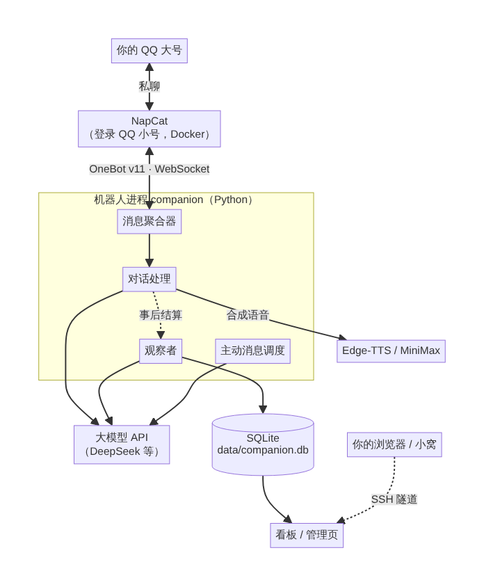

<details>
<summary>图的源码（Mermaid）</summary>

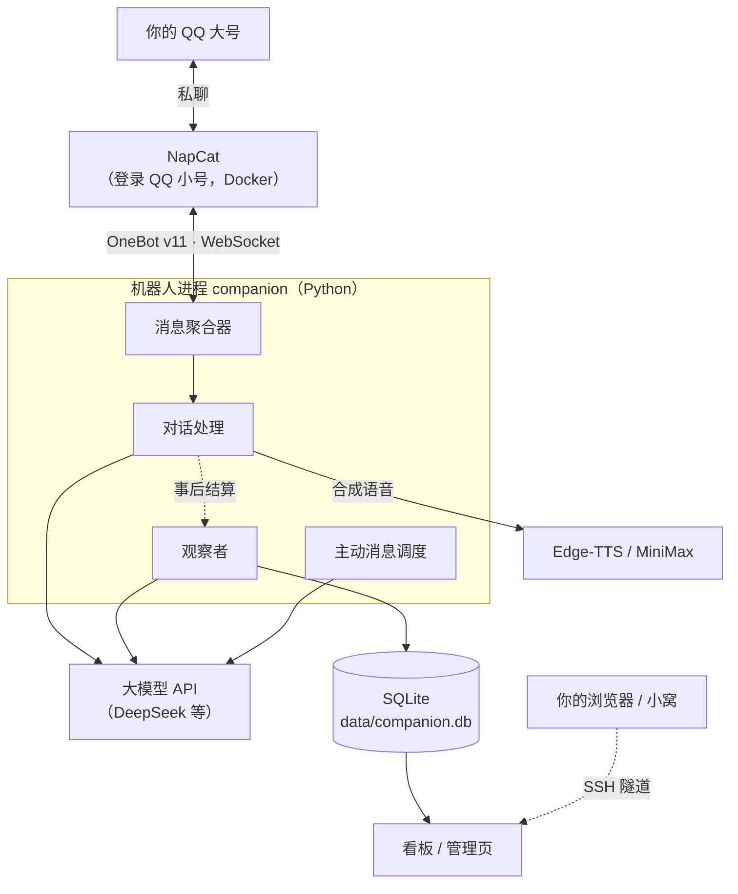

</details>

- **NapCat** 负责登录 QQ 小号，把收到的私聊消息通过 WebSocket 推给机器人，再把她的回复发出去。
- **机器人进程**是一个纯 Python 的异步程序，里面同时跑着几条线：处理你的消息、定时考虑要不要主动找你、事后结算好感和记忆、提供看板网页。
- **所有状态都在一个 SQLite 文件里**：聊天记录、日记、事实、情绪、好感、表情包、费用账本。备份它就等于备份了"她"。

---

## 2. 一条消息的旅程

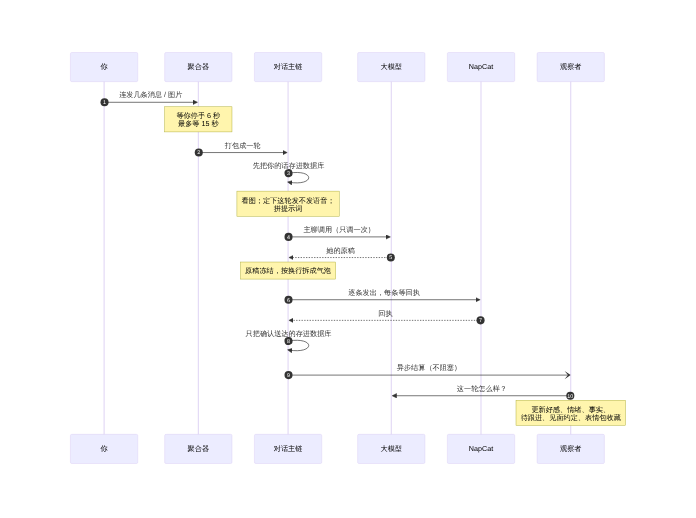

<details>
<summary>图的源码（Mermaid）</summary>

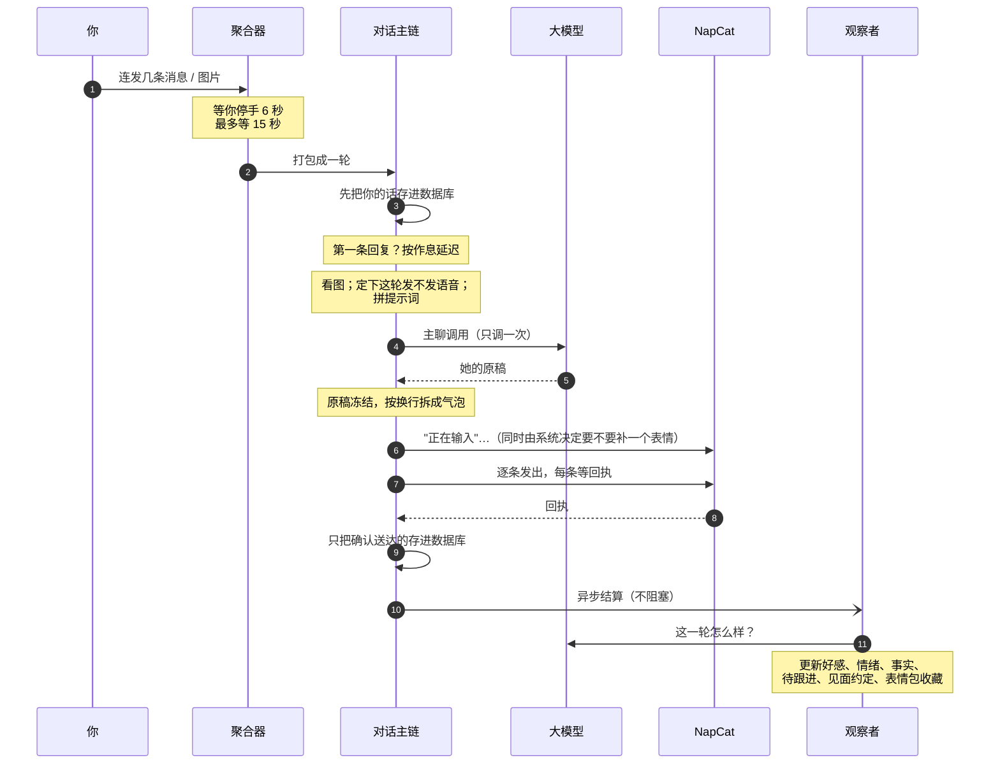

</details>

几个关键点：

1. **先等你说完**。真人聊天经常一句话拆成好几条发。聚合器在你停手 **6 秒**后才认为这一轮说完了；从第一条算起最多等 **15 秒**。NapCat 能上报你"正在输入"时，它会再多等一会儿，但不会无限等。
2. **你的话先入库**。消息一到就保存，之后看图、生成、发送哪一步出了事，这句都不会丢。
3. **只生成一次，原稿不改**。模型写出来的话按换行拆成几条气泡，之后不润色、不裁剪，也不会换个模型重写。模型不需要输出任何标记；万一输出了，这份原稿作废，由系统发一句固定的兜底短句。
4. **只认回执**。每条气泡发出去都要等 NapCat 确认。被明确拒绝就停在那里，后面的不再发；结果不确定时不重发，免得你收到两遍。数据库里只存确认送达的那部分。发到一半停机，已经送达的同样会存下。
5. **道别之后不追**。你说了去忙、去睡、先这样，30 分钟内又只补了一个表情，这一轮她不回，只把你的表情记下。
6. **表情由系统补**。她写完话之后，一次很小的后台调用会看一眼"他说了什么、她回了什么"，从卡里的表情包和 QQ 小黄脸里挑一个，或者不挑。挑中的跟在最后一条气泡后面发出，她的原话不动。最近 5 次回复里发过就不再发，最近用过的 5 个不重复，所以只是偶尔出现。发过的表情会作为投递记录跟在那一轮后面，她下一轮知道自己发过什么。
7. **结算放到事后**。好感、情绪、记事这些"想一想"的工作交给观察者异步做，不拖慢她回你。

这一整套只保证一件事：**她说了什么、实际发了什么、存了什么、下一轮读到什么，四者一致。**

> 代码：`companion/aggregator.py`、`companion/kernel/production.py`、`companion/kernel/delivery.py`、`companion/kernel/expression.py`、`companion/observer.py`

---

## 3. 她为什么不秒回

秒回是机器人最容易露馅的地方。她的回复时机分两段：

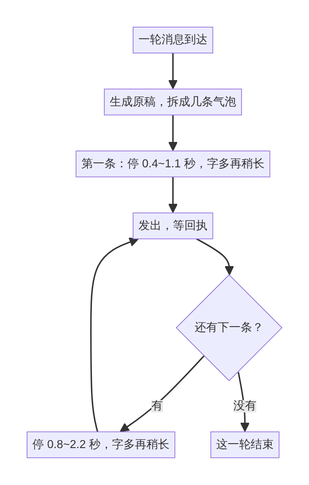

<details>
<summary>图的源码（Mermaid）</summary>

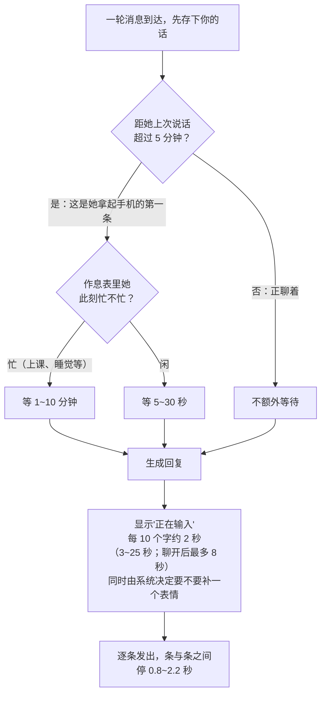

</details>

- **第一条才延迟**："她拿起手机"的判据是她上一次说话已经过去 5 分钟以上。聊开之后就正常接话，不会每句都拖。
- **延迟先于看消息**：等待发生在拼提示词之前，相当于"她还没看到消息"。等完再去取当时的时间和状态，提示词里的"现在几点"才准确。你的话在等待之前就已经存好了，等的这段时间里出任何事都不会丢。
- **"正在输入"按字数演**：生成完才知道她要说多少字，所以输入时长在生成之后才算。只算她打出来的字，用语音发的那条不算。
- **条与条之间有停顿**：每条气泡发出前停 0.8～2.2 秒，字越多停得越久一点。
- 首条延迟和"正在输入"可以分别在 `[timing]` 里关掉；出任何异常都会降级成"不等了，直接发"，不会卡住。

> 代码：`companion/turn_runtime.py` 的 `wait_first_reply`、`play_typing`，`companion/replier.py` 的 `wait_before_chunk`；参数在 `config.example.toml` 的 `[timing]` 与 `[reply]`

---

## 4. 提示词怎么拼

每轮主聊的提示词由三部分组成：一段系统提示词、最近的对话、你这一轮的话。系统提示词里的顺序是**越稳定的越靠前**。

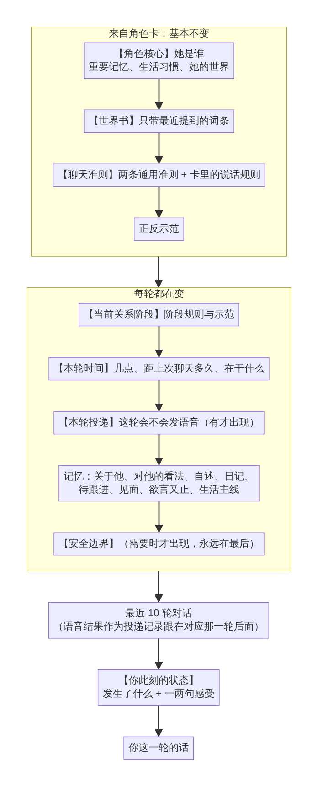

<details>
<summary>图的源码（Mermaid）</summary>

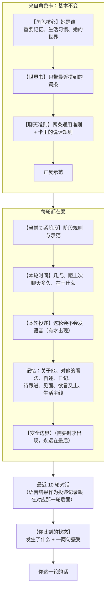

</details>

几点说明：

- **她读到的只有自然的话**。好感的六个维度、心情的数值都不进提示词，只给一两句结论，比如"心情不错，在对方身边很安心"。
- **状态紧挨着你这句话，而且先说发生了什么**。这一段不放在系统提示词中间，而是放在最后、紧贴你这一轮的话。实测同一句状态埋在几千字中间时她基本不受影响，挪到最后才会真的带着这个状态说话。冷落也不写成"有些委屈"这种形容词，而是写成事实，比如"他已经 2 天 3 小时没找你了，这期间你主动找过他 2 次，他都没回"。模型知道一个人碰上这种事会怎么说话，形容词它反而不知道该怎么演。语音、引用、表情的内部标记也不出现，历史里的旧标记在读取时会被剥掉。
- **按需带入，不整本塞**。世界书只带最近 4 轮里提到关键词的词条（最多 4 条、1200 字）；日记只带"还记得"的（见下一节），并且带着写下的日期；事实在开启分层后只带核心加最近、相关的几条。
- **你发的东西先整理再给她看**。连发的几条合成一段；小黄脸会带上一句意思（比如"吃糖"是卖萌、心情好）；图片先由看图模型写成一句描述；引用会写明你引用的是谁说的哪句话。
- **语音的事实跟着对话走**。这一轮会不会发语音，在她动笔之前就写在【本轮投递】里。过去某一轮哪句是语音发的、哪次没发出去，作为一条系统说明紧跟在那一轮后面，随着对话滚出窗口自然消失。
- **稳定的在前也是为了省钱**。模型厂商对"和上次开头相同"的输入按缓存价计费，便宜很多。角色卡的内容每轮不变、放在最前，就能长期命中缓存。

> 代码：`companion/kernel/context.py`、`companion/kernel/memory_view.py`、`companion/kernel/semantic.py`、`companion/lorebook.py`

---

## 5. 记忆：为什么会忘、怎么想起

### 5.1 三层记忆

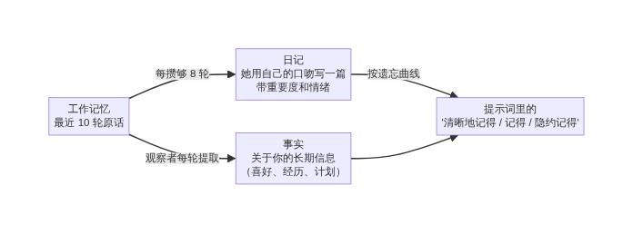

<details>
<summary>图的源码（Mermaid）</summary>

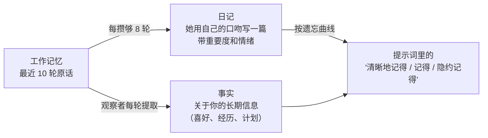

</details>

- **工作记忆**：最近 10 轮原话，原样放进提示词，保证她接得上刚才的话。
- **日记**：每攒够 8 轮你的消息，后台让模型以她的视角写一篇日记，打上重要度（1~10）和情绪（温暖、感动、不安、平静……）。
- **事实**：观察者每轮从对话里提取关于你的事，比如"他最近想学做锅底"。新事实和旧事实冲突时，旧的会被作废替换。

### 5.2 遗忘曲线

日记不会永远留在她脑子里。每篇日记的"记忆强度"随时间指数衰减：

```
强度 = 重要度 × (1 + 0.3 × log₂(被想起次数 + 1)) × e^(−天数 / τ)

τ（时间常数）= max(10, 重要度 × 6.8) 天
             × (1 + 0.15 × 被想起次数)
             × 2（正面情绪）或 × 1.5（负面情绪）
```

强度低于 **0.5** 就算"淡忘了"，不再出现在提示词里。按这个公式，一篇日记能被记住多久：

| 日记 | 大约能记住 |
|---|---|
| 重要度 1 的琐事 | 7 天 |
| 重要度 5 的普通一天 | 78 天 |
| 重要度 8、正面情绪 | 300 天 |
| 重要度 10、正面情绪、被想起过 8 次 | 3 年 |

几个设计上的考虑：

- **带情绪的事记得更久**：正面情绪的时间常数翻倍，负面的乘 1.5，和人一样。
- **心情差时更容易想起难过的事**：她当前心情低落时，负面日记在排序上加权 1.5 倍。
- **按强度分级说法**：强度 ≥ 5 写成"清晰地记得"，≥ 2 写成"记得"，其余"隐约记得"，她说话的笃定程度跟着变。最多带 15 篇。

### 5.3 回忆加固

被想起的记忆会记得更牢：

- 你说"还记得……"或"想你"时，所有还没淡忘的日记被想起次数 +1；
- 你说的话和某篇日记有 **3 个以上相同汉字**时，那一篇 +1。

每次被想起，从这一刻起重新计时，时间常数也变长。**已经淡忘的不会被复活**，避免她突然"想起"一件早该忘了的事。

> 代码：`companion/memory.py` 的 `calc_diary_strength`、`get_active_diaries`、`reinforce_memories`、`check_and_trigger_diary_archive`

---

## 6. 情绪：会波动，也会回落

### 6.1 三个维度

| 维度 | 范围 | 含义 |
|---|---|---|
| 愉悦 v | −10 ~ 10 | 开不开心 |
| 激活 a | −10 ~ 10 | 兴奋还是平静 |
| 安心 t | 0 ~ 10 | 对这段关系有多踏实 |

另外还有一个"冷落感"（0~10），只在你长时间不理她时上升。

### 6.2 均值回归：情绪总会慢慢回到她的基调

情绪用 **Ornstein-Uhlenbeck 过程**建模：受刺激会偏离，但总会被一股"回归力"慢慢拉回基线，同时带一点随机波动。

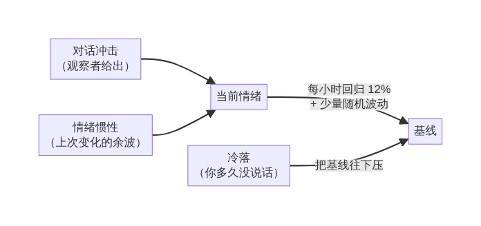

<details>
<summary>图的源码（Mermaid）</summary>

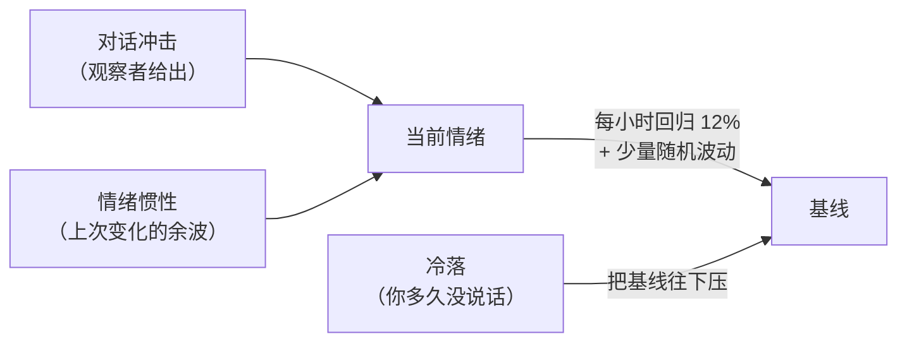

</details>

- **基线随关系变**：愉悦的基线 = 2 + min(2, 好感复合分 ÷ 50)。关系越好，她平时越开心。
- **对话冲击**：观察者每轮给出这一轮让她开心 / 激动 / 安心了多少，单轮冲击有上限（愉悦、激活各 ±2），防止一句话就让她大起大落。
- **情绪惯性**：上一次的变化会留一点余波，情绪不会瞬间翻转。
- **安心感回归很慢**：每天只回归 5%，基线随关系阶段从 3 升到 8 以上。初识时小心翼翼，越熟越踏实。

### 6.3 冷落：按真实时间算

你最后一次说话后的 **12 小时内**不算冷落。之后：

- 愉悦的回归目标被逐渐往下压（每小时 0.15，最多压 4），激活压一半；
- 冷落感按时间累积：一天约 0.24，两天约 2.2，三天约 6，约 89 小时到顶 10；
- 安心感慢慢磨损。

冷落量按"经过了多少小时"积分计算，和程序多久检查一次无关，所以不会因为调度频率不同而让她"更生气"或"没感觉"。你一回话，冷落感开始消退。

她心情差到愉悦 < −6 时，不会主动找你装没事（见第 8 节）。

> 代码：`companion/mood.py` 的 `update_mood`、`neglect_level`

---

## 7. 好感与关系阶段

### 7.1 从一轮对话到六个维度

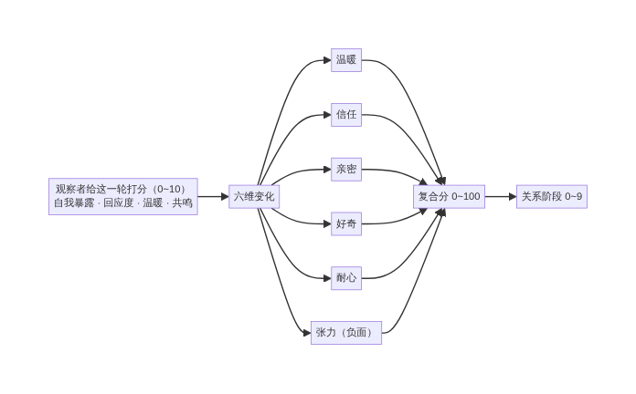

<details>
<summary>图的源码（Mermaid）</summary>

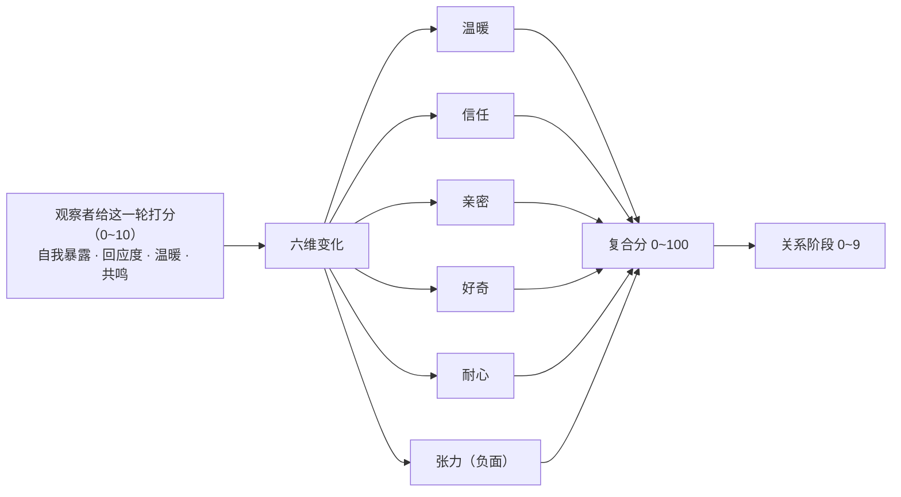

</details>

- **打分换算**：比如温暖维看"温暖"分，亲密维看"自我暴露 + 共鸣"。每轮每维最多变 ±2。
- **越高越难涨**：复合分超过 20 后，涨幅乘一个阻力系数 r = (100 − 复合分) ÷ 80。到 100 时阻力为 0，所以永远不会破百。
- **每天自然衰减**：每维每天扣一点（例如温暖 0.3、信任 0.1、张力 0.8）。不聊天关系会慢慢变淡，按整天扣，零头留到下次。

复合分的权重：

```
复合分 = 0.25×温暖 + 0.25×信任 + 0.25×亲密 + 0.10×好奇 + 0.15×耐心 − 0.30×张力
```

### 7.2 十个关系阶段

| 阶段 | 复合分门槛 | 按标准节奏大约第几天到达 |
|---|---|---|
| 0 | 0 | 开局 |
| 1 | 15.0 | — |
| 2 | 37.6 | 约 6 天 |
| 3 | 57.7 | 约 20 天 |
| 4 | 72.4 | 约 45 天 |
| 5 | 79.4 | 约 75 天 |
| 6 | 85.7 | 约 120 天 |
| 7 | 91.6 | 约 209 天 |
| 8 | 93.9 | 约 342 天 |
| 9 | 99.5 | 设计上到不了 |

"标准节奏"是：每天聊 30 轮、聊六天歇一天、每轮打分中上（用 `scripts/sim/score_simulation.py` 可以复现）。阶段名字和每个阶段的说话方式写在角色卡里。

- **最后一阶到不了是刻意的**：它是方向，不是终点。十年满分聊天也只到约 98.6。
- **不会在门槛上来回闪**：已经到达的阶段，复合分要跌破"门槛 − 1.5"才会掉下去。出门一周回来不掉阶，一个月不聊照样会掉，衰减是真的。
- **角色卡可以设阶段地板**：比如"永远不低于历史最高阶段减 1"。

> 代码：`companion/affection.py` 的 `STAGE_THRESHOLDS`、`calc_resistance`、`calc_composite_score`、`resolve_stage`、`update`

---

## 8. 她什么时候主动找你

主动消息每隔 20~40 分钟（随机）"醒来"一次，经过三层判断：

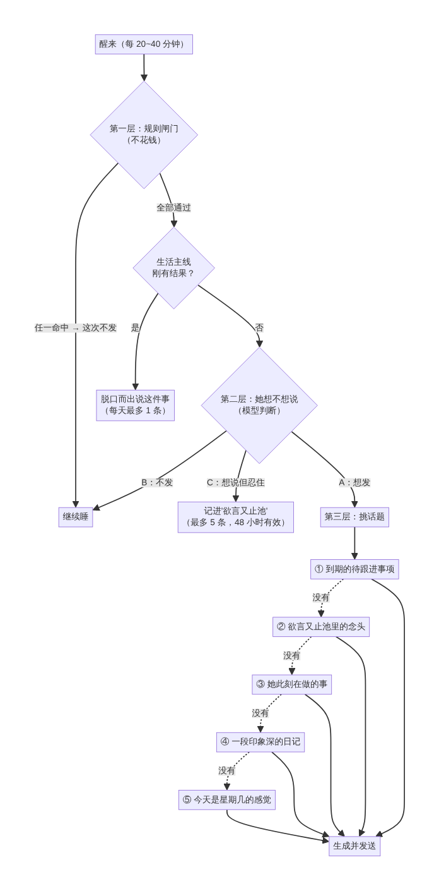

<details>
<summary>图的源码（Mermaid）</summary>

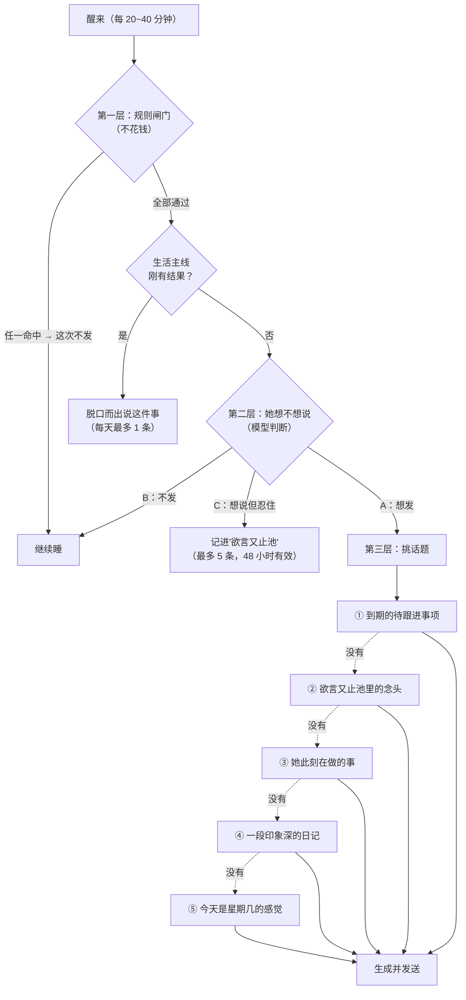

</details>

**第一层规则闸门**，命中任何一条就不发：

- 在免打扰时段（默认 0~8 点）；
- 她上一次说话不到 60 分钟；
- 连续 2 条主动消息你都没回（当天不再发）；
- 上一条主动消息你还没回；
- 你说了"晚安"还不到 6 小时；
- 她心情太差（愉悦 < −6），不装没事；
- 你连续 2 天没回 → 两条主动消息至少隔 48 小时；连续 5 天没回 → 停止主动，你一回话就恢复。

**第二层**让模型以她的身份判断：现在想不想找你。"想说但忍住"的念头不会丢，会进欲言又止池，下次挑话题时优先拿出来。

**第三层**按优先级挑素材。到期的待跟进事项排第一，比如你说过"明天面试"，第二天她会问结果。问过一次就勾掉，你不回也不会天天问。

> 代码：`companion/proactive.py` 的 `trigger_cycle`、`_check_rules_gate`、`_silence_gate`、`_select_topic_material`、`_try_event_channel`

---

## 9. 她自己的生活：作息与生活主线

**作息表**写在角色卡的 `daily_routine` 里，按小时（可以分工作日和周末）描述她在做什么。它影响三件事：

- 提示词里的【她此刻】；
- 第一条回复延迟多久（忙 1~10 分钟，闲 5~30 秒）；
- 能不能发语音（睡觉、上课这类场景不方便说话；你点名要语音时会放行）。

**生活主线**解决"她的生活是即兴编的，说完就蒸发"的问题：

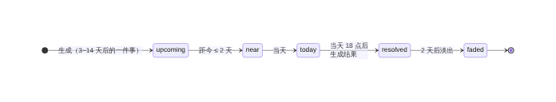

<details>
<summary>图的源码（Mermaid）</summary>

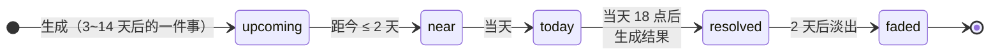

</details>

- 她手上同时有 2~3 件"接下来要做的事"（比如一次考试、一趟出门），按日期往前推进；
- 到了那天 18 点后，这件事会有一个结果，并触发一条"脱口而出"的主动消息；
- 主线只往提示词里加事实，不碰情绪和好感。它出任何问题都静默降级，不影响聊天。

角色卡的 `life_arc_seed_pool` 决定主线从哪些题材里生，`calendar_anchors` 给出开学、考试周这类日历锚点。

> 代码：`companion/persona.py`、`companion/arcs.py`

---

## 10. 语音是怎么发出来的

思路是"**模型只写自然正文，发不发语音由程序决定，并且在她动笔之前就告诉她**"。模型不用学任何语音标记，她写的话和系统做的事也对得上。

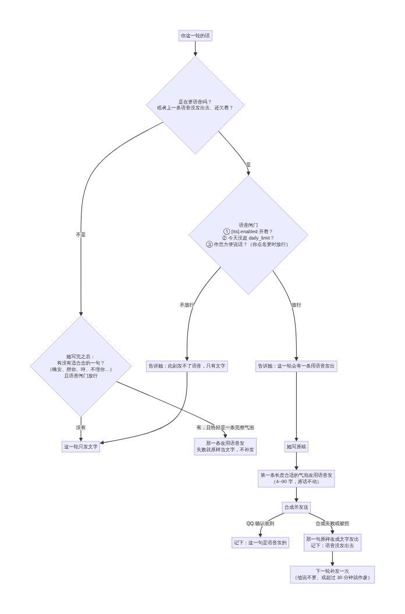

<details>
<summary>图的源码（Mermaid）</summary>

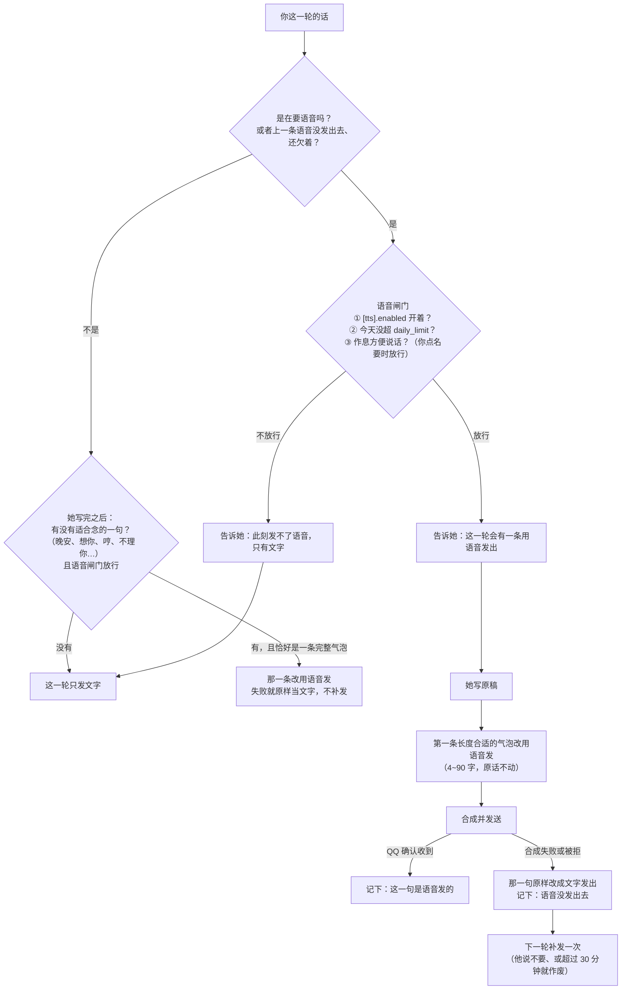

</details>

- **怎么算"在要语音"**：用规则匹配讨要的说法，比如"发条语音""来个语音""想听你声音""唱一句"，或者直接追问"语音呢"。只是提到这两个词不算，比如"外面声音好吵""刚才那条语音真好听"。"别发语音""不用发语音"会被识别成拒绝。这套规则是句式匹配，会有判不准的时候。
- **生成前告知**：放不放行在她动笔前就定了，并作为一条事实写进提示词。她知道这轮会出声，写出来的话才不会是"今天不想说话"。
- **哪一句变成语音**：原稿里第一条长度合适的气泡。只换发送方式，一个字都不改；单条最多 90 字（约 30 秒）。
- **以回执为准**：只有 NapCat 确认收到才算发出。失败时那一句原地变成文字，不会多出一句解释。
- **结果她读得到**：哪一句是语音发的、哪次没发出去，会作为投递记录跟在那一轮对话后面，下一轮她就知道真实情况。
- **补发一次**：答应了却没发出去的，下一轮由系统补一条。你明确说不要了，或者已经过了 30 分钟，就不再补；补发又失败也不会一直追。
- **你没要的时候**：她写完话之后，程序会看有没有适合念出来的一句。句子里有晚安、想你、舍不得、哼、不理你、早点睡这类词得 2 分，带语气词或感叹、问号再加 1 分；"嗯""好的"这种应答是 0 分。2 分以上、并且恰好是一条完整气泡的才会改用语音，同样要过闸门。这种语音事先不告诉她，没发出去就原样当文字，不挂记录、不补发。她主动找你时用的是同一套。

> 代码：`companion/voice_planner.py`、`companion/kernel/production.py`、`companion/kernel/delivery.py`、`companion/runtime_state.py`、`companion/tts.py` 的 `check_gate`

---

## 11. 几条贯穿全局的设计纪律

读代码时会反复看到这几条，它们是这个项目踩过很多坑后定下来的：

1. **增强功能坏了不能拖垮主对话**。识图、语音、生活主线、事后结算……每一项都包在异常处理里，失败就降级成更朴素的行为，她照样回你。
2. **新功能默认关闭**。功能关闭时，提示词和行为应当和没加这个功能时完全一样（很多测试就是在锁这一点）。
3. **按真实时间算，不按调用次数算**。情绪回归、冷落、好感衰减都按真实经过的时间积分，不会因为程序跑得勤或懒而结果不同。
4. **以事实为准，不让她说没发生的事**。语音、表情、引用以协议回执为准；见面以约定的时间为准，没到点不写纪要。
5. **能用规则就不调模型**。规则闸门、语音判定、输入整理都是纯代码，只在真正需要"理解"的地方（主聊、观察者、日记、主动决策）调用模型，省钱也更稳定。
